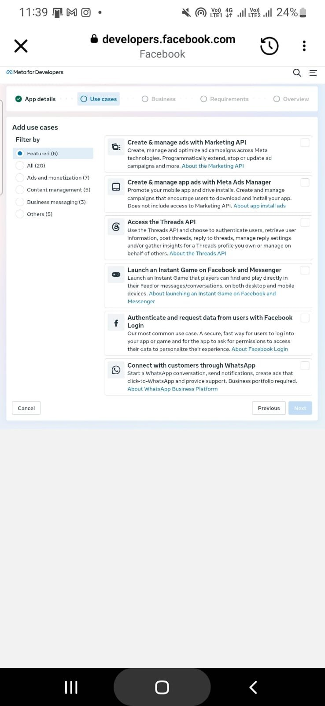
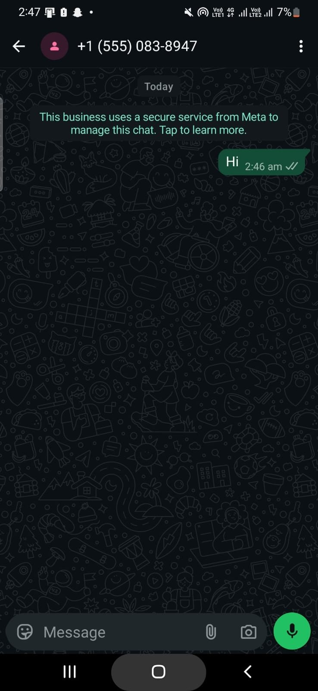
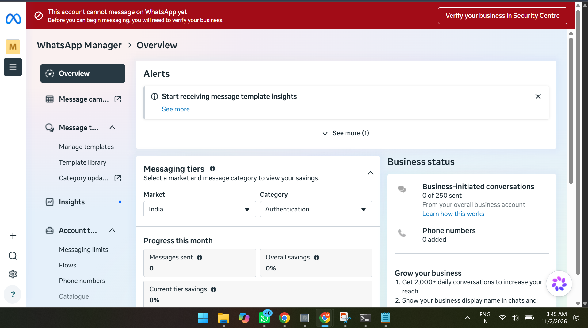
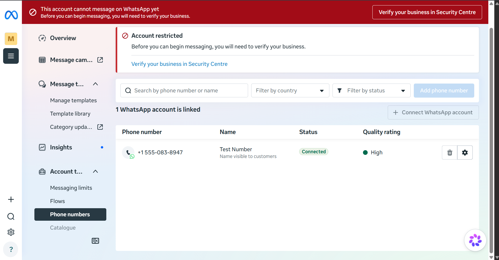
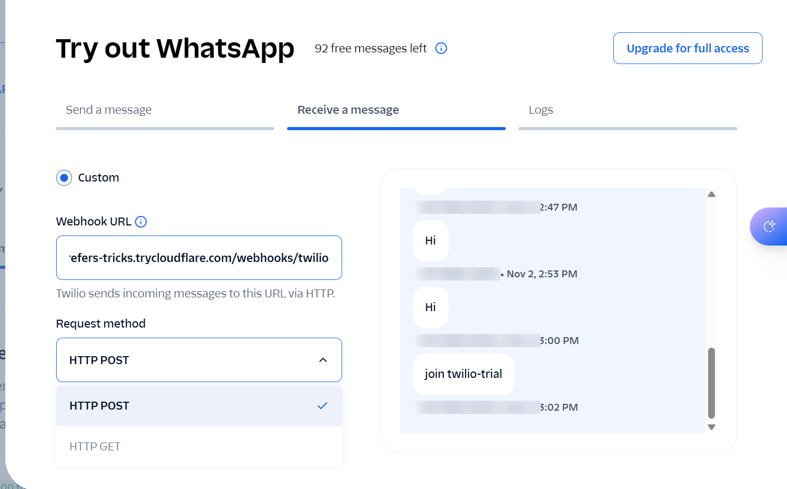
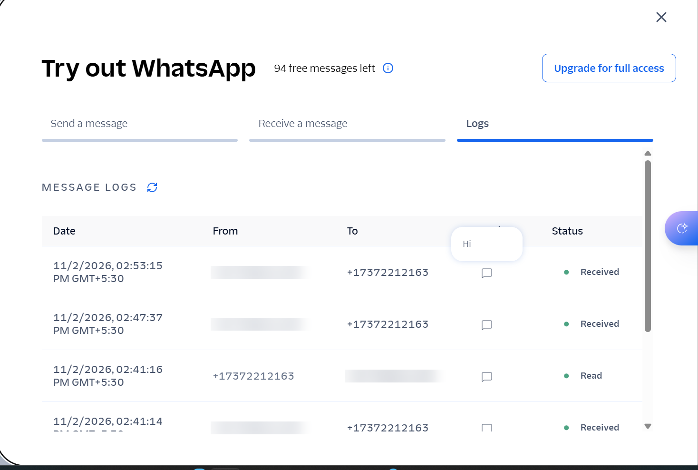
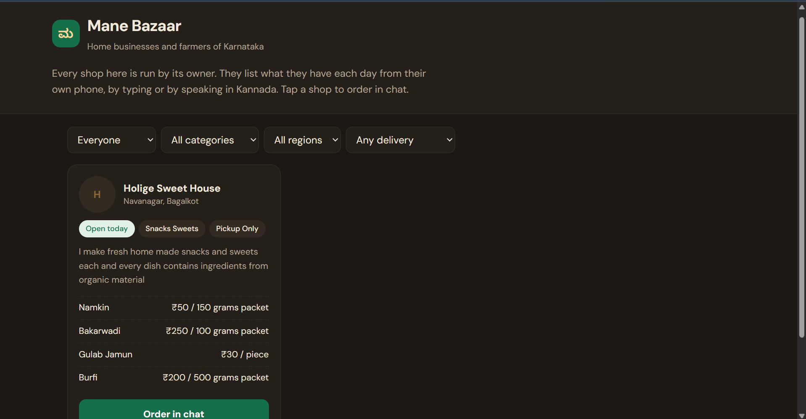
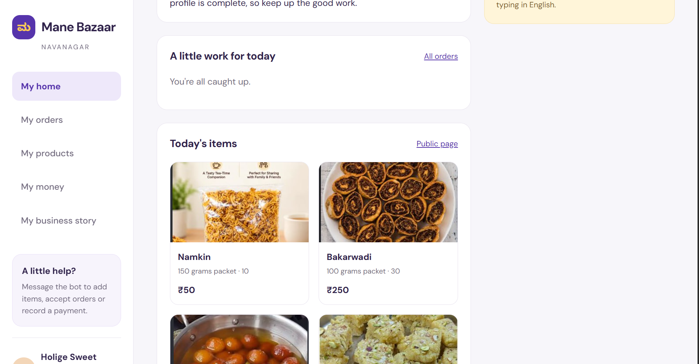

# How we built Mane Bazaar: what failed, and what we did instead

This is the honest log of the build: every wall we hit, how we confirmed it was a wall, and the alternative we chose. We kept it because the failures shaped the product as much as the features did.

---

## 1. WhatsApp Cloud API: the account that could not message

**Goal:** sellers live on WhatsApp, so the bot had to live there too.

**What we did**
1. Created a Meta app with the *Connect with customers through WhatsApp* use case and a business portfolio.
2. Got Meta's free test number, added a verified recipient and generated an access token.
3. Ran a small Node server, exposed it with a Cloudflare tunnel, verified the webhook and subscribed to the `messages` field.
4. Sent messages through the Cloud API.

**What happened**
- The API returned **HTTP 200 with message IDs**, but nothing ever arrived on the phone.
- Our "Hi" reached the test number, so the chat itself existed.

- Our first webhook test failed with "connection refused": the tunnel was up, but the server window had been closed. Lesson: one window for the server, one for the tunnel, one for commands.
- WhatsApp Manager then showed the real cause:

**How we confirmed it**
- Meta's support assistant confirmed the restriction applies to test accounts too, that there is no review path for development use, and that a personal ID is not accepted for business verification.
- We are students without a registered business. Verification asks for business registration details, and **we chose not to submit details for a business we do not run.**

**Result:** WhatsApp Cloud API was blocked for us. Time spent: about a day.

---

## 2. Twilio WhatsApp sandbox: messages in, nothing out

**Goal:** reach real WhatsApp without our own business verification, through Twilio's shared sandbox number.

**What we did**
1. Joined the sandbox from a phone with `join twilio-trial`.
2. Pointed the sandbox's custom webhook at our tunnel (`/webhooks/twilio`, HTTP POST).

**What happened**
- **Inbound worked:** every "Hi" reached our server.
- **Outbound never did.** Twilio's logs show only *Received* rows after our webhook was connected, and no reply was ever sent.

- We tried two ways to reply:
  1. A TwiML reply in the webhook response produced no outbound message.
  2. Sending through the REST API returned **error 21654 "ContentSid Required"**, although we sent no template variables. Twilio's documentation lists that error only for requests that include template variables, so we could not resolve it.
- Each test also spent the trial's 100 free messages, so we stopped after a fixed time box.

**Result:** inbound only. We stopped after the time box instead of spending the hackathon on it.

---

## 3. The pivot: same agent, Telegram as the channel

Telegram needs no business verification, supports voice notes, photos, video and **inline buttons**, and lets any account message a bot.

- We kept the agent core channel-independent: `handle(message) → { text, buttons }`.
- Telegram is wired in `server.js`; a WhatsApp adapter can replace it once a verified business account exists.
- **Tap-to-answer buttons** made onboarding easier than WhatsApp would have allowed without approved templates.

---

## 4. Setting up on an unstable connection

| Problem | What we did |
|---|---|
| `npm install` kept failing with `ECONNRESET` | Installed packages in small groups; only `grammy`, `express` and `dotenv` went through |
| The `openai` package would not download | Replaced it with plain `fetch` calls to Meta's OpenAI-compatible endpoints |
| `better-sqlite3` would not download | Switched to Node's **built-in `node:sqlite`** (Node 22.5+); nothing to download |
| `ffmpeg-static` would not download | Installed ffmpeg system-wide (`winget install Gyan.FFmpeg`) |
| API calls timed out mid-conversation | Added a timeout and one retry to every Meta call; the bot no longer loses a reply to one dropped connection |
| `t.me` links timed out in the browser | "Order in chat" now uses `tg://resolve` to open the Telegram app directly, with a web link as fallback |

---

## 5. Bugs we hit while building, and the fixes

| What broke | Why | Fix |
|---|---|---|
| `401 invalid_api_key` | The key's 15-character **label** had been copied instead of the secret | Created a new key and copied the secret value |
| `table sellers has no column named token` | `CREATE TABLE IF NOT EXISTS` does not add new columns | Reset the test database, then added small migrations (`ALTER TABLE … ADD COLUMN`) |
| Saying "ok" or "thank you" created duplicate orders | The model treated a closing word as a new confirmation | `place_order` now refuses an identical order within 15 minutes, and the prompt lists orders already placed |
| The bot stopped after a button tap | Telegram expires a tap after ~15 s; one failed reply crashed the bot | Ignore late tap replies, and a global error handler keeps the bot running |
| The public page jumped back to one shop every 5 s | A `#shop-…` anchor was re-applied on every refresh | Scroll to the anchor once, on first load |
| The page looked brown | A dark-mode rule changed the palette | Removed it; one fixed theme |
| The brief said "0 pending orders, 0 unpaid…" | The prompt told the model to use all the numbers | It now skips figures that are zero |
| Items vanished every morning | Items were tied to the date | Items now persist; each morning the agent asks *Same / Change some / Start new* |
| `db.js` disappeared | Copying a folder over `src` replaced the whole folder | Restored from GitHub; copy files, not folders |

---

## 6. Where the models needed help

- **Handwritten notebook (sideways photo):** the first read got 2 of 6 numbers wrong, and our own correction made it worse. We changed the prompt to read the page in any orientation, read the **price for one unit**, keep size ranges in the item name, put offers like "10% off above 5000" in a separate note, and **flag unclear digits instead of guessing**. Replying to a photo now makes the bot read that photo again.
- **A video of the seller talking:** Muse Spark correctly said it saw a person and no clothes. That showed us what sellers would actually do, so videos are now **watched and listened to**: Muse Voice Transcribe takes the speech, Muse Spark the picture, and the agent combines both.
- **Licence answers:** an early answer said "you can keep selling while you learn about it". That came from our prompt ("never say she must stop selling"). We changed it: legal requirements are now stated plainly, with the simplest way to meet them, and never softened.
- **Photo clean-up:** Muse Image redraws the picture rather than masking it, so we check that the product looks the same and **always keep the original**.

---

## 7. What we would do next

- WhatsApp adapter, once a verified business account exists.
- Use **SAM 3.1's mask** so the clean-up only changes the background.
- An offline version on cheap phones with **Muse Glimmer**, Meta's open-weight on-device model.
- Several shops per account, hosted storage and a proper login for the dashboard.
